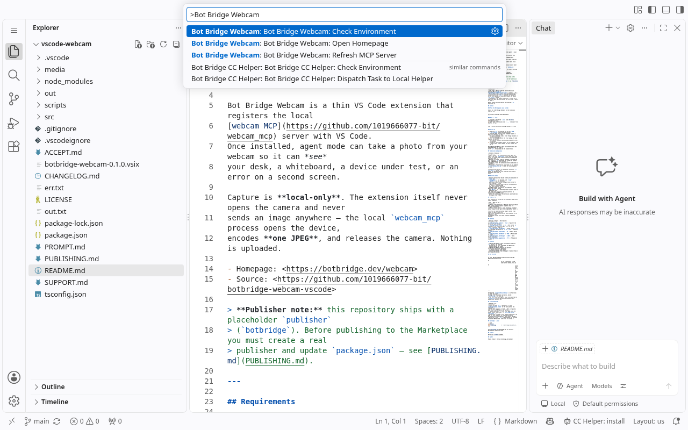
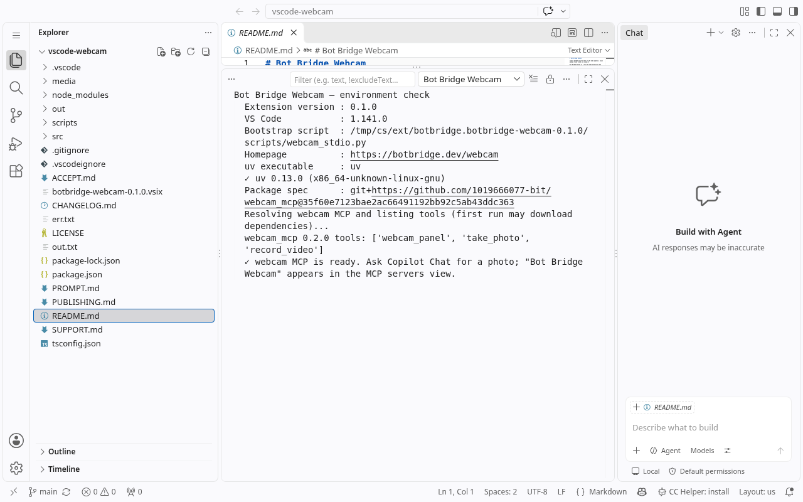
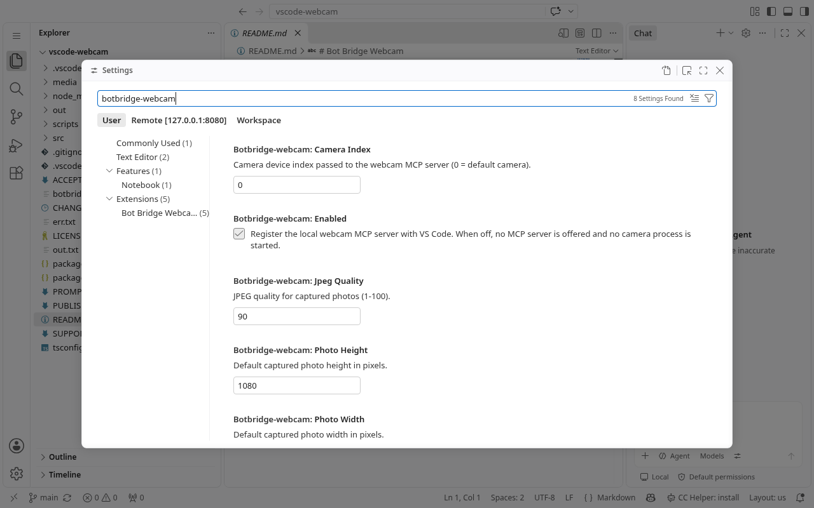

# Bot Bridge Webcam

**Give GitHub Copilot Chat and VS Code agents a local webcam — one click, no cloud.**

Bot Bridge Webcam is a thin VS Code extension that registers the local
[webcam MCP](https://github.com/1019666077-bit/webcam_mcp) server with VS Code.
Once installed, agent mode can take a photo from your webcam so it can *see*
your desk, a whiteboard, a device under test, or an error on a second screen.

Capture is **local-only**. The extension itself never opens the camera and never
sends an image anywhere — the local `webcam_mcp` process opens the device,
encodes **one JPEG**, and releases the camera. Nothing is uploaded.

- Homepage: <https://botbridge.dev/webcam>
- Source: <https://github.com/1019666077-bit/botbridge-webcam-vscode>

> **Publisher note:** this repository ships with a placeholder `publisher`
> (`botbridge`). Before publishing to the Marketplace you must create a real
> publisher and update `package.json` — see [PUBLISHING.md](PUBLISHING.md).

---

## Screenshots

The commands, the environment check and the settings, as they appear in the
editor. The environment check resolved the pinned package and listed the MCP
tools (`webcam_panel`, `take_photo`, `record_video`) without opening the camera.







## Requirements

| Requirement | Why |
| --- | --- |
| **VS Code 1.101+** | The MCP server definition provider API (`vscode.lm.registerMcpServerDefinitionProvider`) landed in 1.101. |
| **[uv](https://docs.astral.sh/uv/getting-started/installation/)** on `PATH` | Launches the webcam MCP server in an ephemeral Python environment. No manual `pip install` needed. |
| **A webcam** + OS camera permission | Granted to VS Code/uv by your operating system the first time a photo is taken. |

Python itself does not need to be installed: `uv` provisions it.

## Install

### From the Marketplace (once listed)

Search for **Bot Bridge Webcam** in the Extensions view, or run:

```
ext install botbridge.botbridge-webcam
```

### From a `.vsix`

1. Download or build the `.vsix` (see [Building](#building-a-vsix)).
2. In VS Code: **Extensions view → `...` → Install from VSIX…**, or run:

```
code --install-extension botbridge-webcam-0.1.0.vsix
```

### First run

1. Make sure `uv` is installed and on your `PATH`
   (`uv --version` should print a version).
2. Open the **MCP servers** view (Command Palette → *MCP: List Servers*, or the
   MCP icon in the Chat view). **Bot Bridge Webcam** is listed automatically.
3. Start it once and confirm the trust prompt. VS Code requires an explicit
   confirmation before an extension-provided MCP server is launched.
4. In Copilot Chat **agent mode**, ask for a photo, e.g.
   *"Take a photo with my webcam and tell me what you see."*

Run **Bot Bridge Webcam: Check Environment** from the Command Palette any time to
verify `uv`, the package and the exposed tools.

## Permissions and privacy

| Concern | Behaviour |
| --- | --- |
| Camera access | The **extension** never opens the camera. The local `webcam_mcp` process does, only when a tool is invoked, and releases the device immediately after each shot. |
| Network | No image, frame or metadata is uploaded by this extension. `uv` downloads the pinned MCP package from GitHub/PyPI on first run only. |
| Telemetry | None. The extension collects and sends no usage data. |
| Filesystem | The extension only reads its own bundled `scripts/webcam_stdio.py`. It does not write captures to disk. |

The one external action is dependency resolution: `uv run --with …` fetches the
webcam MCP package the first time the server starts. Everything after that is
local.

### Security notes

- The two settings that decide **what gets executed** — `uvPath` and
  `packageSpec` — are declared with `"scope": "machine"`, and the extension
  additionally ignores any workspace-level value for them. Opening a cloned
  repository therefore cannot redirect the executable or inject a Python package
  that this extension would run.
- The MCP package is pinned to an **immutable commit SHA** (the commit behind
  tag `v0.2.0`), so a moved tag cannot silently swap in different code.
- VS Code still asks you to **trust/confirm** an extension-provided MCP server
  before it is launched; this extension cannot and does not bypass that prompt.

## Free vs. Pro

This extension is **free and MIT-licensed**, and covers single snapshots.

| Tier | What you get |
| --- | --- |
| **Free** (this extension) | Register the local webcam MCP; single **take a photo** snapshots that are released immediately. |
| **Pro** | Burst capture, video recording, countdown and an always-on tray app — **not implemented here**. |

The **Pro tier and the desktop Helper (system tray / always-on capture) are sold
separately** and are not part of this extension or its repository. This
marketplace listing will never silently enable Pro features.

## Settings

| Setting | Default | Description |
| --- | --- | --- |
| `botbridge-webcam.enabled` | `true` | Register the MCP server with VS Code. |
| `botbridge-webcam.uvPath` | `uv` | Path to the `uv` executable. Use an absolute path if it is not on `PATH`. **Machine scope.** |
| `botbridge-webcam.packageSpec` | pinned commit (`v0.2.0`) | Package spec passed to `uv run --with`. **Machine scope.** |
| `botbridge-webcam.cameraIndex` | `0` | Camera device index. |
| `botbridge-webcam.photoWidth` | `1920` | Photo width in pixels. |
| `botbridge-webcam.photoHeight` | `1080` | Photo height in pixels. |
| `botbridge-webcam.jpegQuality` | `90` | JPEG quality (1–100). |

## Commands

- **Bot Bridge Webcam: Check Environment** — prints `uv` version, the resolved
  package and the tools exposed by the MCP server, without opening the camera.
- **Bot Bridge Webcam: Refresh MCP Server** — re-registers the server definition
  so changed settings take effect.
- **Bot Bridge Webcam: Open Homepage** — opens <https://botbridge.dev/webcam>.

## How it works

```
VS Code  ──registerMcpServerDefinitionProvider──▶  McpStdioServerDefinition
                                                        │
                        uv run --no-project --with <pkg> python webcam_stdio.py
                                                        │
                                                  webcam_mcp (stdio)
                                                  ├─ take_photo   → one JPEG
                                                  ├─ webcam_panel → in-chat UI
                                                  └─ record_video → Pro placeholder
```

The bundled `scripts/webcam_stdio.py` is a few lines: it reads the camera
settings from environment variables, builds a `ServerConfig`, and runs the
server over stdio. All capture logic lives upstream in
[`webcam_mcp`](https://github.com/1019666077-bit/webcam_mcp), which is MIT.

## Troubleshooting

| Symptom | Fix |
| --- | --- |
| "could not find `uv`" | Install uv, or set `botbridge-webcam.uvPath` to the full path of the executable. |
| Server never appears | VS Code 1.101+ is required. Open **MCP: List Servers** and refresh. |
| "Camera unavailable" | Close other apps using the webcam (Zoom, Teams, OBS). Try `botbridge-webcam.cameraIndex` = `1`. |
| macOS shows no image | Grant camera permission to VS Code (or your terminal) in **System Settings → Privacy & Security → Camera**, then restart VS Code. |
| First run is slow | `uv` is downloading and building the pinned MCP package. Later runs are cached. |

## Building a `.vsix`

```bash
npm install
npm run package          # -> botbridge-webcam-0.1.0.vsix
```

See [PUBLISHING.md](PUBLISHING.md) for the full Marketplace submission steps.

## License

MIT — see [LICENSE](LICENSE).

## Author

Moying Studio · <https://botbridge.dev/webcam>
